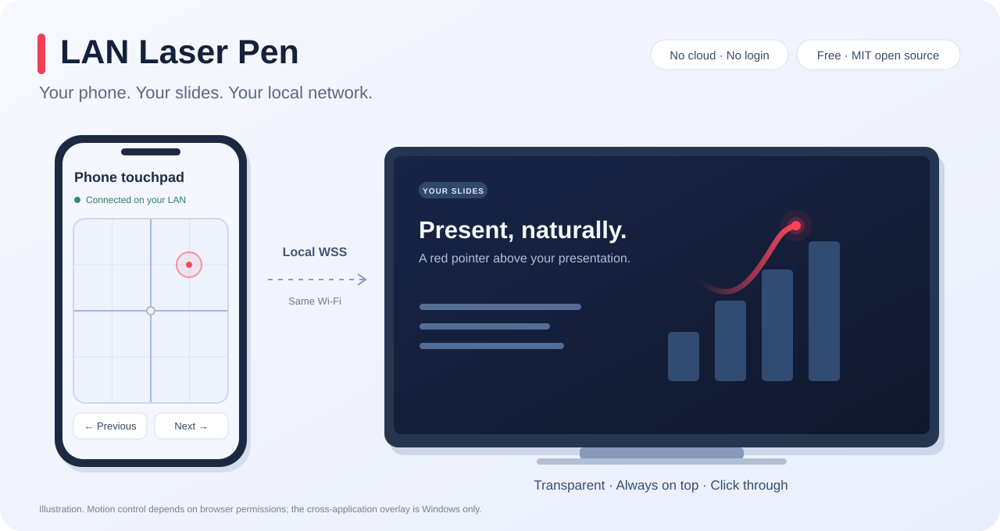
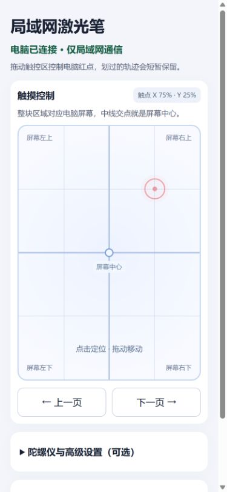

# LAN Laser Pen · 局域网激光笔

[English](./README.MD)

**让手机通过局域网，控制 Windows 演示画面上的激光红点。**

电脑生成二维码，手机扫码后拖动触控区，红点就能叠加在幻灯片上。浏览器允许访问传感器时，还可以使用陀螺仪控制。激光笔本身无需云服务、账号或付费。



## 功能

- **手机触控：**大触控区采用绝对位置映射，带横竖中位线和本地位置标记。
- **Windows 透明叠加：**置顶、点击穿透，尽量保持当前演示窗口的焦点。
- **渐隐轨迹：**红点划过后留下约 500 毫秒的短暂轨迹。
- **可选传感器控制：**兼容检测方向事件、相对姿态和重力倾斜备用，提供归零、灵敏度、方向反转与一阶低通滤波；是否可用取决于浏览器与系统权限。
- **上下翻页：**向 Windows 当前前台应用发送左右方向键；使用时让 Canva 或其他演示窗口保持前台。
- **局域网配对：**电脑二维码、本地 HTTPS/WSS、断线重连，每个会话由一部手机控制。



## 快速开始

准备一台 **Windows 电脑**、Git、**Node.js 22 或更新版本**，以及连接同一局域网的手机。安装依赖和首次下载 mkcert 需要联网；启动器使用 Windows PowerShell，跨应用透明叠加仅提供 Windows 实现。

```powershell
git clone https://github.com/fuxing0910-hue/lan-laser-pen.git
Set-Location lan-laser-pen
npm ci
powershell -NoProfile -STA -ExecutionPolicy Bypass -File .\scripts\launch.ps1 -Action Start
```

启动器会构建网页、按需准备本地 HTTPS 证书、启动服务与透明层，并打开电脑二维码页。首次可能弹出 Windows 本地 CA 信任确认。若防火墙询问网络访问，请为可信的专用局域网放行；手机连不上时可按详细指南检查防火墙。

**手机第一次需要安装并信任证书：**

1. 将生成的 **`certs/rootCA.cer`** 复制到手机，安装并信任为 CA 证书。只传这个公开文件，所有私钥留在电脑上。
2. 如果在 **iOS 上使用 Safari**，安装证书描述文件后，还需要进入 **设置 → 通用 → 关于本机 → 证书信任设置**，为这个 CA 开启完全信任。参见 [Apple 官方说明](https://support.apple.com/en-us/102390)。
3. 重新打开手机浏览器，扫描电脑二维码，确认 HTTPS 页面没有证书警告。电脑有多个网卡时，在二维码页选择手机能够访问的局域网地址。
4. 直接拖动触控区即可控制红点，无需启用传感器。想试陀螺仪时，再点击启用或授权按钮，允许出现的权限请求，然后校准归零。

这需要本地安装与首次证书配置。不同系统版本的证书菜单和传感器权限可能不同。完整安装、端口放行与故障排查见 [详细安装指南](./README.LOCAL.zh-CN.md)。

停止服务与透明层：

```powershell
powershell -NoProfile -STA -ExecutionPolicy Bypass -File .\scripts\launch.ps1 -Action Stop
```

`Ctrl+Alt+Q` 只退出透明层。仓库还提供 `Start-LaserPen.vbs` 和 `Stop-LaserPen.vbs`，可在启用 VBScript 的 Windows 上双击使用；上面的 PowerShell 命令不依赖这些入口。

## 兼容情况：目前掌握的证据

| 手机 / 浏览器 | 当前情况 | 验证范围 |
| --- | --- | --- |
| iPhone | 用户反馈可用。 | 未提供具体型号、iOS 或浏览器版本，不能当作 Safari 的专项实测结果。 |
| 华为 Mate X5 / 自带华为浏览器 | 用户反馈陀螺仪控制可用。 | 未提供准确系统与浏览器版本。 |
| 华为 Pura X，VDE-AL10 / 华为浏览器 | 触控可用；传感器访问返回 `NotAllowedError`。 | 该环境下尚未确认陀螺仪可用。 |
| 其他手机浏览器 | 触控面向支持 Pointer Events 且使用可信 HTTPS 的浏览器；传感器按能力检测。 | 尚未对所有机型与浏览器组合进行真机测试。 |

**跨应用透明叠加仅支持 Windows。** 其他桌面系统没有随项目提供的跨应用透明层或此 Windows 启动器，普通浏览器预览也不具备该叠加能力。

浏览器拒绝所有传感器来源时，网页无法绕过它的权限决定；此时仍可使用触控区控制激光点。

## 局域网运行与隐私

运行时，指针位置和翻页指令通过本地 WSS 在手机与电脑间传输，不使用外部中转、统计服务、登录或支付流程。Canva 等演示软件自身的联网需求独立于本项目。

传感器诊断包含权限状态、事件计数、最近读数及有限的浏览器版本摘要。服务端仅将最新快照保存在内存中，自最后一次报告起最多保留 **10 分钟**，手机断开后也可查看；接受新的手机连接时清空旧快照。诊断不写入数据库，也不上传云端；启动器和进程日志保存在本地 `.tools/`。

请勿在公开 issue 中上传 `certs/`、`.tools/`、私钥或未脱敏的本地诊断。

## 参与改进

欢迎提交问题、浏览器兼容反馈及小范围 PR。报告传感器问题时，请提供手机型号、系统与浏览器版本、页面显示的权限和事件状态，并移除私网信息与证书材料。

开发检查使用 OpenSSL 自动生成隔离的临时证书，无需预先安装系统证书信任：

```powershell
npm test
npm run lint
npm run build:demo
```

如果它帮到了你的演示，欢迎自愿点个 Star。

## 许可与上游来源

[MIT 许可](./LICENSE)。基于 [SilentTiger/laser-pen 的 `9694f27` 提交](https://github.com/SilentTiger/laser-pen/tree/9694f27b846cd1baff527be2f9d14fdf86234854) 改造，保留其 canvas 绘图核心与原始版权声明，新增局域网控制及 Windows 透明叠加。
